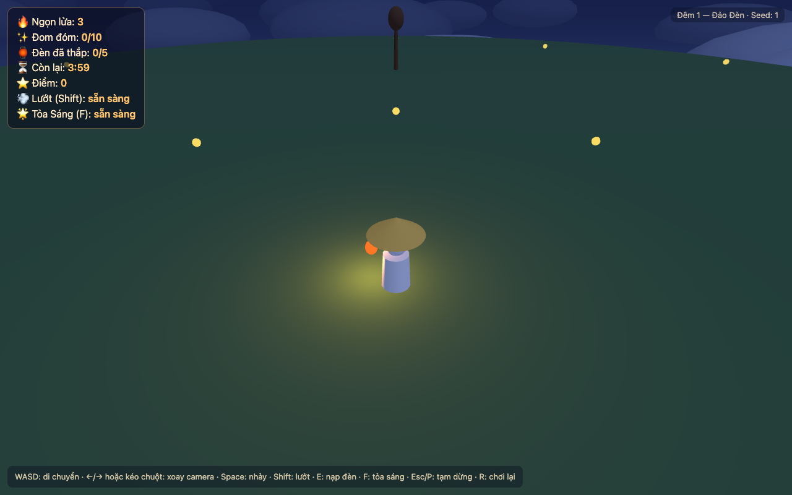
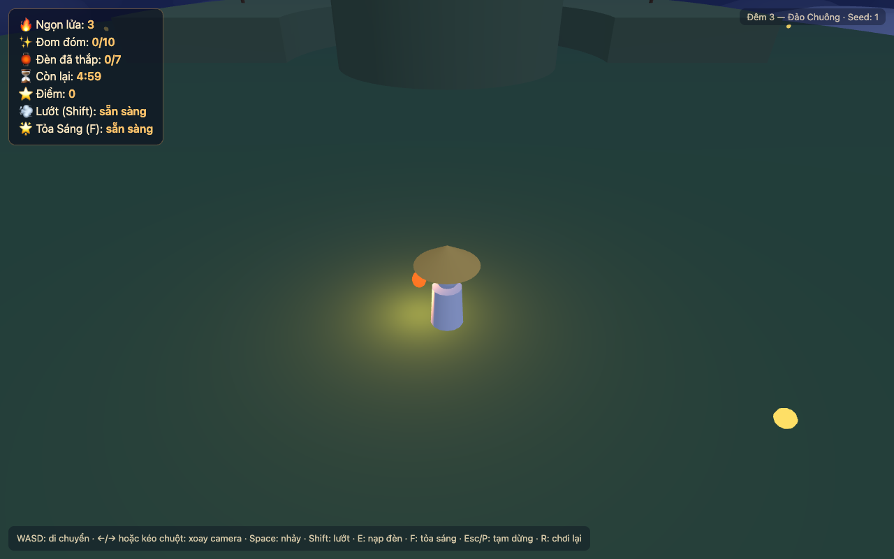
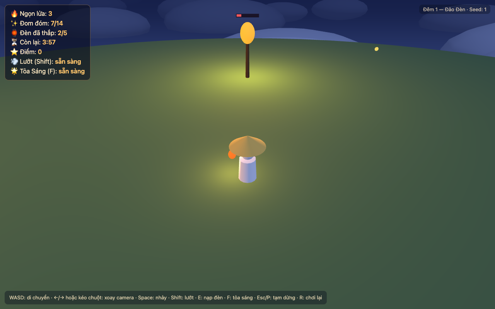

Video demo: xem Release v1.0.0

# Đảo Đèn Lồng

Game 3D góc nhìn thứ ba chạy trên trình duyệt (TypeScript + Three.js + Vite). Đêm xuống trên những hòn đảo lơ lửng giữa biển mây: bạn là một đám Mây nhỏ, nhặt đom đóm, nạp cho các ngọn đèn lồng, giữ cho đèn không cạn dầu, tránh Bóng Mực và Gió Lạc, và sống sót tới bình minh với ít nhất 60% số đèn còn sáng. Có 3 Đêm (Đảo Đèn, Đảo Cau, Đảo Chuông).

| Đêm 1 | Đêm 3 | Thanh dầu đèn |
|---|---|---|
|  |  |  |

## Yêu cầu hệ thống

- Node.js ≥ 20 và npm (đã thử với Node 26).
- Trình duyệt có WebGL2 (Chrome, Edge, Firefox, Safari bản gần đây). Có GPU thì mượt hơn; WebGL phần mềm vẫn chạy nhưng chậm.
- Chạy bench cần thêm Chromium của Playwright: `npx playwright install chromium` (một lần).

## Cài đặt và chạy (3 lệnh)

```bash
git clone https://github.com/lytrann236/K5-L3A-DAY12-TranThiLy-2A202603404-AI-SDLC-Dao-Den-Long.git && cd K5-L3A-DAY12-TranThiLy-2A202603404-AI-SDLC-Dao-Den-Long
npm ci
npm run dev
```

Mở địa chỉ Vite in ra (mặc định http://localhost:5173). Thêm `?seed=123` để cố định seed, `?night=2` để vào thẳng Đêm 2.

### Chạy bản web đã build

```bash
npm run build && npm run preview     # http://localhost:4173
```

Hoặc tải `dao-den-long-web-v1.0.0.zip` ở GitHub Release v1.0.0, giải nén rồi phục vụ thư mục bằng bất kỳ web server tĩnh nào (ví dụ `npx serve .`). Không mở trực tiếp `index.html` bằng `file://` vì trình duyệt chặn module.

## Điều khiển

| Phím | Tác dụng |
|---|---|
| W A S D | Di chuyển theo hướng camera |
| ← / → hoặc kéo chuột trái | Xoay camera |
| Space | Nhảy |
| Shift | Lướt |
| E | Nạp đom đóm vào đèn (thắp / châm dầu / thắp lại) |
| F | Tỏa Sáng (choáng và đẩy lùi Bóng Mực) |
| Esc hoặc P | Tạm dừng |
| R | Chơi lại Đêm |

Phím đọc theo `event.code` nên dùng được cả khi bật bộ gõ tiếng Việt. Chưa hỗ trợ đổi phím (xem `docs/notes/phase-4.md`).

## Kiểm thử

```bash
npm test               # Vitest (243 test)
npx tsc --noEmit       # kiểm kiểu
```

### Chạy headless (Test Contract v1.3)

```bash
npx tsx src/headless/cli.ts --seed 1 --night 1 --ticks 600 --out out.jsonl \
  [--scenario scenarios/<file>.json] [--inputs inputs/<file>.json] [--snapshot-every 10]
```

Đầu ra JSONL gồm `snapshot`, `event` và dòng `end`; cùng seed/scenario/inputs cho output giống hệt nhau. Bằng chứng từng phase sinh bằng `scripts/proof.sh N` vào `docs/proof/phase-N/` (không sửa tay).

### Benchmark

```bash
npx playwright install chromium     # một lần
npx tsx scripts/bench.ts --seed 42 --duration 30 --out bench.json
```

Tự `npm run build` nếu chưa có `dist/`, phục vụ bằng `vite preview`, mở Chromium **có cửa sổ** 1280×720 tại `?bench=1&seed=42&duration=30` và ghi `bench.json` (`avg_fps`, `p1_low_fps`, `frame_ms_p95`, `frames`, `load_ms`, …). Cảnh: Đêm 1, 200 Bóng Mực `wander`, 100 đom đóm, L1–L3 sáng fuel 100, camera bay vòng r 30 m cao 15 m (15 s/vòng), 3 s khởi động. Cần máy có màn hình (không chạy được trên máy chủ không có display).

- **vsync:** script truyền `--disable-gpu-vsync --disable-frame-rate-limit`; `vsync_off` chỉ là `true` khi fps đo được vượt hẳn 60 Hz (> 75), nếu không là `false`.
- **`peak_mem_mb` là `null`:** đây là bản web, trang không đọc được RSS tiến trình trình duyệt; RSS đo từ ngoài sẽ lẫn nhiều tiến trình Chromium (GPU, renderer, network), không phải bộ nhớ của game.
- Số trong repo (`bench.json`) đo trên Apple M2, 16 GB, macOS (Darwin 24.6): avg 635 fps, p1 low 254 fps, p95 2.6 ms, load 1,6 s.

### Soak test

```bash
npx tsx scripts/soak.ts --seed 7 --nights 10 --out soak.json
```

10 Đêm liên tiếp (1→2→3 xoay vòng) trong một tiến trình, Đêm thứ i dùng seed 7+i, input ngẫu nhiên theo seed (đổi hướng mỗi 30 tick; mỗi tick 5% nhảy, 3% lướt, 2% tỏa sáng, 10% tương tác). Ghi `soak.json` với `crashes`, `results`, `mem_start_mb`, `mem_end_mb`, `duration_s`; thoát mã 0 khi `crashes = 0` và `mem_end_mb ≤ 1.2 × mem_start_mb`.

## Luật chơi tóm tắt

Mọi số liệu nằm trong `game.contract.json` (v1.3) — nguồn duy nhất của tuning. Đặc tả đầy đủ: `docs/notes/phase-3.md` (luật hiện hành), `docs/notes/phase-2.md`, `docs/notes/phase-1.md`.

- 3 ngọn lửa (máu); mỗi đèn cần 10 đom đóm để thắp; đèn hao 1 dầu/giây, tắt khi hết dầu, thắp lại tốn 5.
- Thắng ở bình minh khi còn ≥ 60% số đèn sáng; hết lửa hoặc quá ít đèn là thua.
- Bóng Mực hút dầu đèn yếu (`fuel < 30`); Tỏa Sáng choáng chúng.

## Tài liệu

- [`docs/notes/phase-4.md`](docs/notes/phase-4.md) — Phase 4: tiêu chí AC4-xx, kết quả bench/soak, phần chưa làm
- [`CHANGELOG.md`](CHANGELOG.md) — thay đổi theo phase · [`CREDITS.md`](CREDITS.md) — ghi công · [`docs/notes/ai-log.md`](docs/notes/ai-log.md) — nhật ký dùng AI

## Harness AI (Claude Code)

Làm cùng Claude Code với bộ harness trong repo: [`CLAUDE.md`](CLAUDE.md) (hướng dẫn agent), hook `Stop` chặn kết thúc khi test đỏ (`.claude/hooks/`), skill `verify-proof`, subagent `reviewer` chỉ đọc (`.claude/`).

## Giấy phép

MIT — xem [`LICENSE`](LICENSE).
